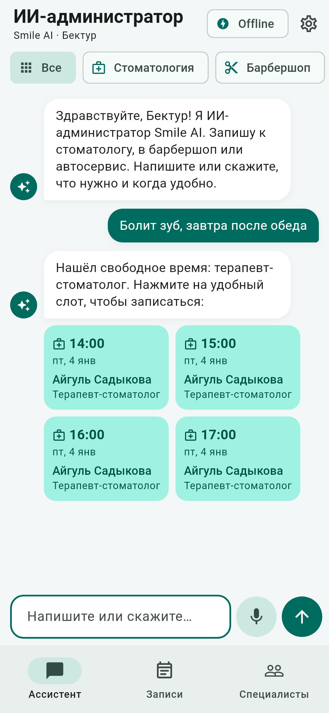
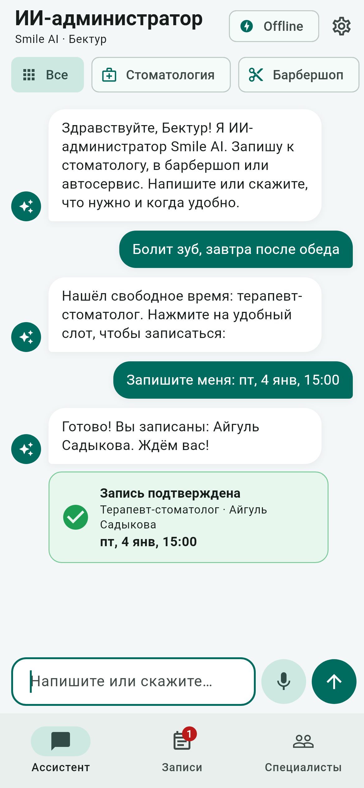
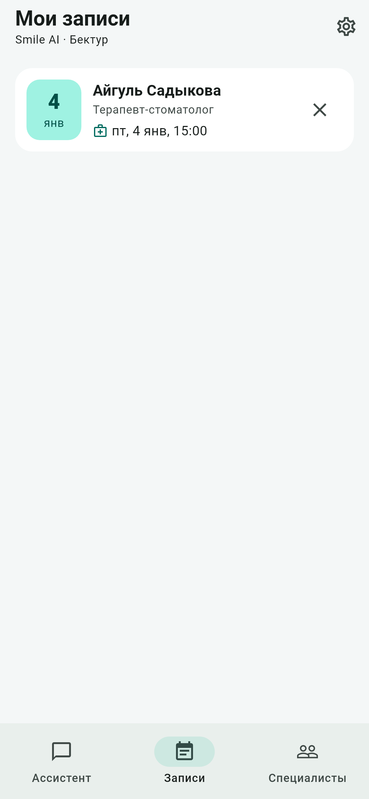
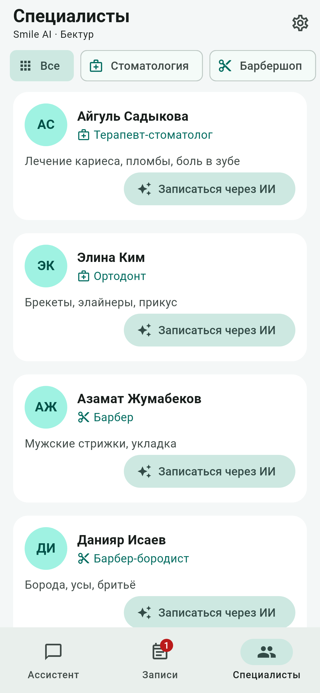
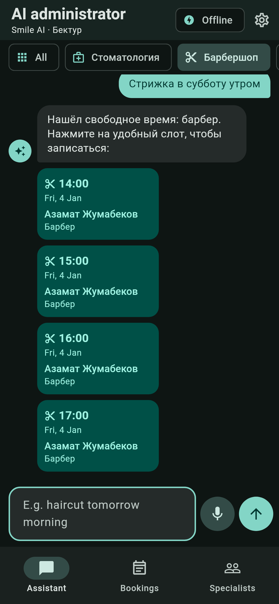

# Smile AI — AI administrator that books anything from one sentence

Cross-platform mobile app (Flutter + Bloc). The client writes or **says** one sentence —
*"my tooth hurts, tomorrow after lunch"*, *"haircut on Saturday morning"*, *"oil change on Friday"* —
and the server's AI assistant picks the right specialist, finds free time and shows it as tappable
cards. One tap creates the booking. Bookings can be moved or cancelled right in the chat.

| Chat | Booked | My bookings | Specialists | Dark + English |
|---|---|---|---|---|
|  |  |  |  |  |

| Requirement | How it is met |
|---|---|
| Cross-platform mobile app (Flutter) | `app/` — Android, iOS and Web from one codebase |
| Mobile communicates with server | REST API in `server/` (FastAPI). Auth, specialists, bookings and AI chat all go over HTTP + JSON with a Bearer token |
| Pushed on GitHub | This repository, with CI: server tests, `flutter analyze`, `flutter test`, web build and an installable Android APK |
| State management (Bloc) | `flutter_bloc`: `AuthBloc`, `ChatBloc`, `AppointmentsBloc`, `DoctorsBloc`, `SettingsCubit` |

## Features

- **Three businesses in one app**: dental clinic, barbershop, car service (11 specialists). A new business is a few rows in `server/app/db.py`
- **AI chat**: describe what you need and when → slot cards → tap to book → confirmation card
- **Voice input**: press the microphone, say the request, it is sent automatically
- **Reschedule and cancel in chat**: "перенеси мою запись на пятницу", "отмени запись к барберу"
- Two assistant modes, shown as a badge in the app bar:
  - **AI** — any OpenAI-compatible LLM with tool calling (`find_slots`, `book_appointment`, `reschedule_appointment`, `cancel_appointment`, `list_my_appointments`)
  - **Offline** — built-in Russian/English keyword parser. Used when no API key is set or the LLM fails, so the demo always works
- Register / login, session kept between launches
- My bookings: list, pull-to-refresh, cancel with confirmation, badge counter
- Specialists: filter by business, "Book via AI" asks the assistant about that specialist
- Onboarding, splash screen, app icon, light / dark theme, Russian / Kyrgyz / English interface
- Server rules: Mon–Sat 09:00–18:00, one-hour slots, no double booking, no past times

## Architecture

```
app/lib
├── main.dart                 # providers + AppGate (splash / onboarding / login / home)
├── core/                     # ApiClient (http), config, formatters, strings (RU/KY/EN)
├── data/                     # models + repositories (AuthRepository, ClinicRepository)
├── bloc/                     # events, states, blocs
└── ui/                       # screens + widgets

server/app
├── main.py                   # FastAPI endpoints
├── auth.py                   # PBKDF2 passwords, bearer tokens
├── scheduling.py             # slots, booking, reschedule and cancel rules
├── assistant.py              # LLM tool calling + offline fallback
└── db.py                     # SQLite schema, seed categories and specialists
```

Data flow: `UI → Event → Bloc → Repository → ApiClient → REST API → SQLite / LLM` and back as a new `State`.

## API

| Method | Path | Auth | Description |
|---|---|---|---|
| POST | `/auth/register` | – | `{name, email, password}` → `{token, user}` |
| POST | `/auth/login` | – | `{email, password}` → `{token, user}` |
| GET | `/me` | ✓ | Current user |
| GET | `/categories` | – | Businesses: dental, barber, auto |
| GET | `/doctors?category=` | – | Specialists, optionally of one business |
| GET | `/doctors/{id}/slots` | – | Free slots of a specialist |
| GET | `/appointments` | ✓ | My upcoming appointments |
| POST | `/appointments` | ✓ | `{doctor_id, start: "YYYY-MM-DDTHH:MM"}` |
| PATCH | `/appointments/{id}` | ✓ | `{start}` — move to another time |
| DELETE | `/appointments/{id}` | ✓ | Cancel |
| POST | `/chat` | ✓ | `{message, history, category?, doctor_id?}` → `{reply, slots, appointment, reschedule_id, changed, mode}` |

Interactive docs: http://localhost:8000/docs

## Run

**macOS, one click:** double-click `run_demo.command` in Finder. It starts the server and opens the app in
Chrome at http://localhost:8080 (`./run_demo.command <device-id>` runs it on a simulator or phone).

Manual steps:

### 1. Server

```bash
cd server
python -m venv .venv
source .venv/bin/activate          # Windows: .venv\Scripts\activate
pip install -r requirements.txt
uvicorn app.main:app --host 0.0.0.0 --port 8000
```

Optional AI mode: copy `.env.example` to `.env` and set `LLM_API_KEY`
(works with OpenAI, OpenRouter, Groq, Gemini OpenAI-compatible endpoint — set `LLM_BASE_URL` and `LLM_MODEL`).

Tests: `python -m pytest -q`

### 2. App

```bash
cd app
flutter pub get
flutter run
```

Server address used by the app:
- Android emulator → `http://10.0.2.2:8000` (default)
- iOS simulator / web → `http://localhost:8000` (default)
- Real phone → `flutter run --dart-define=API_URL=http://<your-PC-IP>:8000` (phone and PC on the same Wi-Fi)

Tests: `flutter test`

A ready debug APK is built by CI on every push: GitHub → Actions → latest CI run → artifact
`smile-ai-debug-apk`. It talks to `http://10.0.2.2:8000` (emulator); for a real phone build your own
with `flutter build apk --dart-define=API_URL=http://<your-PC-IP>:8000`.

End-to-end check of the app's HTTP layer and `ChatBloc` against a running server:
`flutter test tool/e2e` (also runs in CI).

Screenshots in `docs/screenshots` are rendered from the real screens by
`flutter test tool/screenshots --update-goldens`.

## Demo script (2 minutes)

1. First launch → onboarding → register. The assistant greets you by name.
2. Type or say *"Болит зуб, завтра после обеда"* → dentist slots after 13:00 appear as cards.
3. Tap a slot → confirmation card, the "Bookings" badge shows 1.
4. Pick **Барбершоп** → *"Стрижка в субботу утром"* → barber slots. Book one.
5. *"Перенеси запись к барберу на пятницу"* → pick a new time → the booking moves.
6. *"Отмени запись к стоматологу"* → it disappears from **Bookings**.
7. Settings (gear) → dark theme, English.
