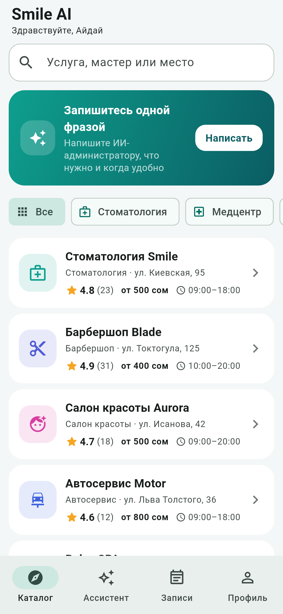
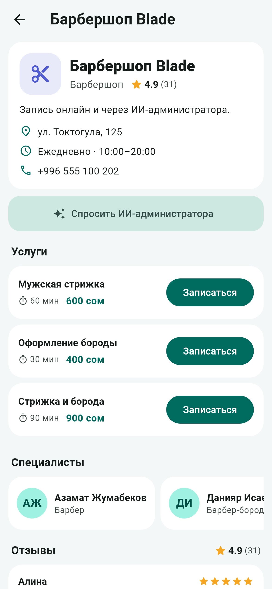
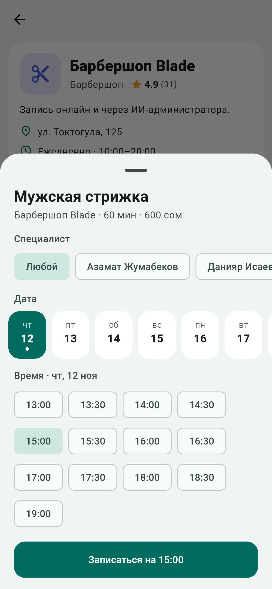
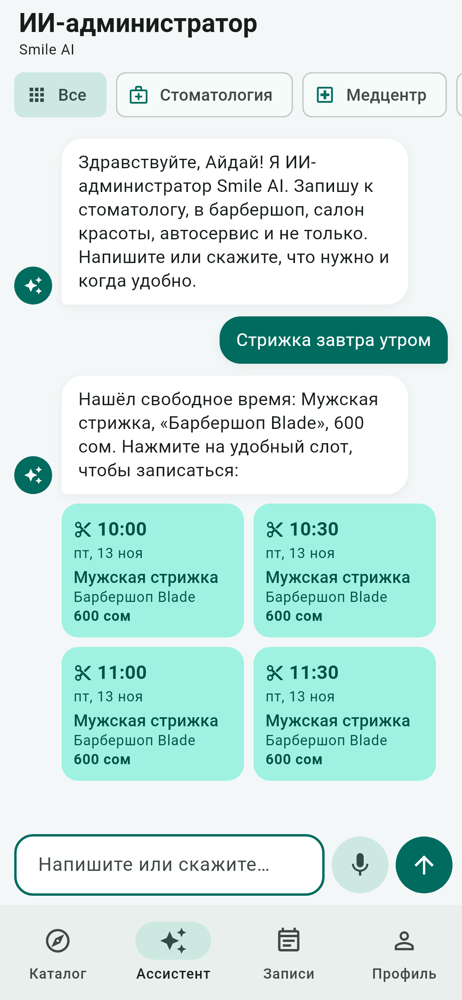
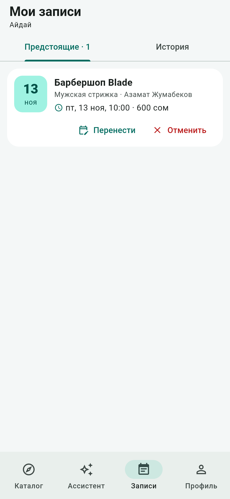
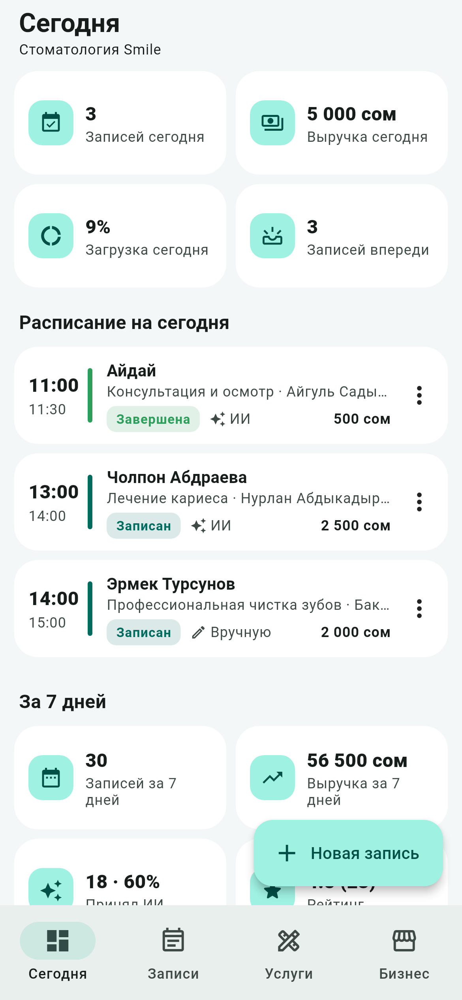
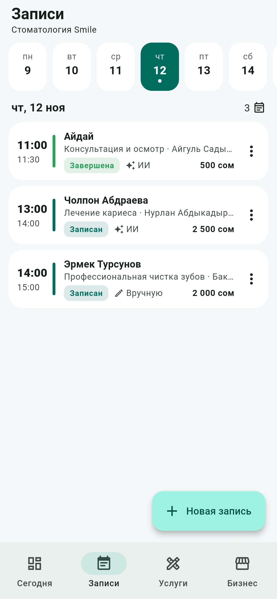
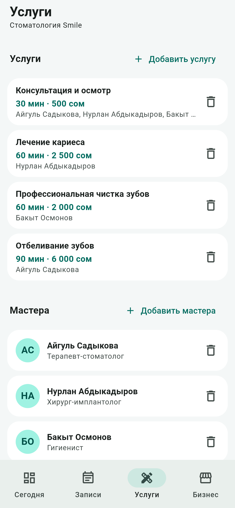
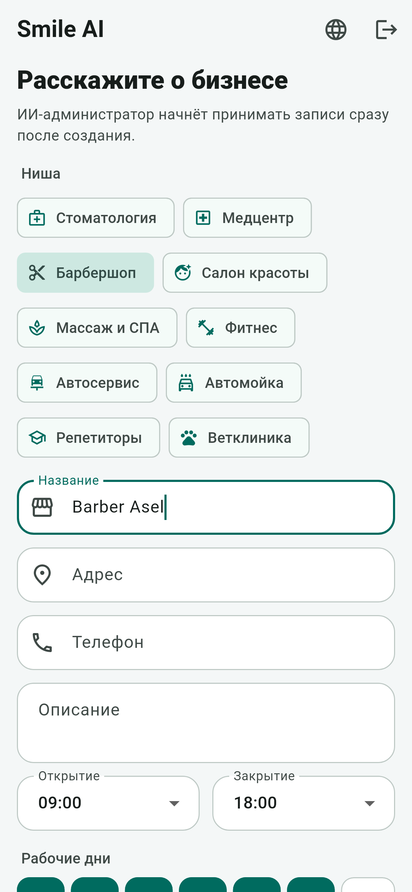
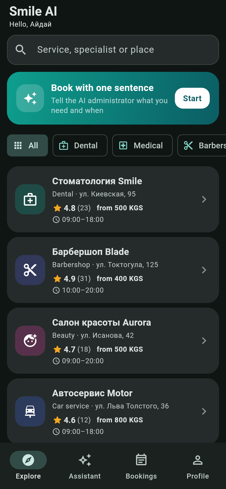

# Smile AI — booking for local services, with an AI administrator

A two-sided product in one Flutter app. **Clients** find a place in the catalog or simply write
or say what they need — *"haircut tomorrow morning"*, *"my tooth hurts, after lunch"* — and the
AI administrator offers free time and books it. **Business owners** register their business in a
minute, get an administrator that takes bookings around the clock, and see their schedule,
clients and revenue.

| Catalog | Business page | Booking | AI administrator | My bookings |
|---|---|---|---|---|
|  |  |  |  |  |

| Owner: today | Owner: schedule | Owner: services and staff | Owner: new business | Dark + English |
|---|---|---|---|---|
|  |  |  |  |  |

| Requirement | How it is met |
|---|---|
| Cross-platform mobile app (Flutter) | `app/` — Android, iOS and Web from one codebase |
| Mobile communicates with server | REST API in `server/` (FastAPI). Sign-in, catalog, bookings, the owner's cabinet and the AI chat all go over HTTP + JSON with a Bearer token |
| Pushed on GitHub | This repository, with CI on every push: server tests on SQLite and PostgreSQL, `flutter analyze`, app tests, an end-to-end test, web, Android and iOS builds |
| State management (Bloc) | `flutter_bloc`: `AuthBloc`, `CatalogBloc`, `ChatBloc`, `AppointmentsBloc` and cubits for booking, the business page, settings and the owner's cabinet |

## What is inside

**For clients**

- Catalog of ten niches: dental, medical, barbershop, beauty, massage and spa, fitness, car
  service, car wash, tutors, vet. Search by service, specialist or place; rating, address and
  starting price on every card.
- Business page: services with duration and price, specialists, reviews, opening hours.
- Booking by calendar: service, specialist (or any), day, time.
- AI administrator: text or **voice**, slot cards from several businesses, moving and cancelling
  a booking by chat. Each business page has its own chat that answers for that business only.
- My bookings: upcoming and history, move, cancel, rate a finished visit.

**For owners**

- Setup: pick a niche, name the business; typical services of the niche are added at once.
- Today: bookings, revenue and load of the day, today's schedule, the last seven days, how many
  bookings the AI took, rating, top services.
- Schedule of any day, statuses (completed, no-show, cancelled), manual booking of a client who
  called or walked in.
- Services and staff: add, change, remove; choose who performs each service.
- Business card, opening hours, working days and a switch that hides the business from the catalog.

**The AI administrator** has two interchangeable engines behind one endpoint. With `LLM_API_KEY`
set it is any OpenAI-compatible model with tool calling. Without a key, or when the model fails,
the built-in assistant answers: it matches services by keyword stems, understands dates and times
in Russian and English, and books, moves and cancels. It reads services from the database, so a
service an owner adds is bookable by chat immediately. It never cancels or moves a booking on a
guess: when it is not clear which booking is meant, it lists them and asks.

Also: Russian, Kyrgyz and English interface, light and dark theme, onboarding, one-tap demo
accounts, a session kept between launches. The full brief is in [docs/PRODUCT_SPEC.md](docs/PRODUCT_SPEC.md).

## Architecture

```
app/lib
├── main.dart            # providers, session scope, AppGate (splash / onboarding / sign-in / app)
├── core/                # ApiClient (HTTP), config, clock, formatters, strings (RU / KY / EN)
├── data/                # models and repositories: auth, catalog, booking, owner
├── bloc/                # blocs and cubits: events in, states out
└── ui/
    ├── screens/         # splash, onboarding, sign-in
    ├── customer/        # catalog, business page, AI chat, bookings, profile
    ├── owner/           # setup, today, schedule, services and staff, business
    └── widgets/         # booking sheet, chat bubbles, cards, date strip, settings

server/app
├── main.py              # FastAPI endpoints
├── auth.py              # PBKDF2 passwords, bearer tokens, roles
├── catalog.py           # niches with service templates and keywords
├── businesses.py        # businesses, services, staff, reviews, statistics
├── scheduling.py        # slots, booking, moving and cancelling rules
├── assistant.py         # LLM tool calling + the built-in assistant
├── seed.py              # demo businesses and demo accounts
└── db.py                # schema and queries (SQLAlchemy Core): SQLite locally, PostgreSQL in the cloud
```

Data flow: `UI → Event → Bloc → Repository → ApiClient → REST API → database / LLM` and back as a
new `State`. Blocs that live as long as the user is signed in sit above the navigator, so every
page, sheet and dialog reaches them; signing out disposes them all.

## API

| Method | Path | Who | Description |
|---|---|---|---|
| GET | `/health`, `/config` | anyone | Liveness; whether demo accounts and the AI mode are on |
| POST | `/auth/register`, `/auth/login`, `/auth/demo` | anyone | → `{token, user}`; registration takes a `role`: `customer` or `owner` |
| GET | `/me` | signed in | Current user |
| GET | `/categories`, `/businesses?category=`, `/businesses/{id}` | anyone | Niches, catalog, one business with services, specialists and reviews |
| GET | `/businesses/{id}/slots?service_id=&date=&specialist_id=` | anyone | Free start times, every 30 minutes |
| GET, POST | `/appointments` | client | My bookings; book `{service_id, specialist_id?, start}` |
| PATCH, DELETE | `/appointments/{id}` | client | Move to another time; cancel |
| POST | `/appointments/{id}/review` | client | `{rating, comment}` after the visit |
| POST | `/chat` | client | `{message, history, category?, business_id?}` → `{reply, slots, appointment, …}` |
| GET, POST, PATCH | `/owner/business` | owner | The business: read, create, change |
| POST, PATCH, DELETE | `/owner/services`, `/owner/specialists` | owner | Services and staff |
| GET, POST, PATCH | `/owner/appointments` | owner | Schedule of a day, manual booking, status |
| GET | `/owner/stats` | owner | Numbers of the dashboard |

Interactive docs: http://localhost:8000/docs

## Run

**macOS, one click:** double-click `run_demo.command` in Finder. It starts the server and opens the
app in Chrome at http://localhost:8080. On the sign-in screen press **Client** or **Owner** to
enter a demo account.

**On a real iPhone from the Mac:** connect the phone, double-click `run_on_iphone.command`.

**Without a computer nearby:** put the server in the cloud once, then the app is installed once
and keeps working — see [docs/DEPLOY.md](docs/DEPLOY.md).

Manual steps:

```bash
cd server
python -m venv .venv
source .venv/bin/activate          # Windows: .venv\Scripts\activate
pip install -r requirements.txt
uvicorn app.main:app --host 0.0.0.0 --port 8000
```

```bash
cd app
flutter pub get
flutter run
```

Server address used by the app: Android emulator `http://10.0.2.2:8000`, iOS simulator and web
`http://localhost:8000`. For anything else build with `--dart-define=API_URL=<address>` or tap
the **Server** line on the sign-in screen and type the address.

Optional AI mode: copy `server/.env.example` to `server/.env` and set `LLM_API_KEY` (any
OpenAI-compatible API; `LLM_BASE_URL` and `LLM_MODEL` choose the provider and the model).

## Tests

| What | Command | Covers |
|---|---|---|
| Server | `cd server && python -m pytest -q` | Booking rules, catalog, owner's cabinet, assistant; runs on SQLite and, with `TEST_DATABASE_URL`, on PostgreSQL |
| App | `cd app && flutter test` | Blocs and cubits, and the whole app tapped through as a client and as an owner on a phone-sized screen |
| End to end | `cd app && flutter test tool/e2e` | The app's HTTP layer and blocs against a running server |
| Screenshots | `cd app && flutter test tool/screenshots --update-goldens` | Renders `docs/screenshots` from the real screens |

App tests run against `app/test/fake_api.dart`, an in-memory stand-in that answers the same REST
calls as the server, so the real repositories, blocs and screens are exercised without a network.

## Demo script (3 minutes)

1. Sign-in screen → **Client**. The catalog opens: search "маникюр", pick a niche.
2. Open **Барбершоп Blade** → **Записаться** → choose a time → the booking appears in **Записи**.
3. **Ассистент** → type or say *"Стрижка завтра утром"* → tap a slot card → confirmation.
4. *"Перенеси мою запись"* → pick a new time. *"Отмени запись"* → it moves to history.
5. **Записи → История** → rate a finished visit.
6. **Профиль → Выйти** → **Owner**. The dashboard shows the day; mark a visit as completed.
7. **Новая запись** → book a walk-in client. **Услуги** → add a service: it is bookable at once,
   by calendar and by chat.
